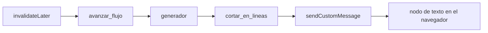

# App de ruido visual

Aplicación Shiny que reproduce en el navegador el efecto de llenar una consola con texto: un flujo continuo de caracteres que se corta cada cierta cantidad de columnas, de modo que cada línea parte donde terminó la anterior y los patrones quedan desfasados entre líneas.

## Archivos

| Archivo         | Contenido                                                             |
|-----------------|-----------------------------------------------------------------------|
| `app.R`         | Interfaz, estado del flujo, loop de animación y handlers de JavaScript |
| `generadores.R` | Generación de fragmentos por modo y corte del texto en líneas          |

## Funcionamiento

1. Un `observe()` se repite cada `intervalo` milisegundos con `invalidateLater()` mientras la app está corriendo.
2. `avanzar_flujo()` calcula cuántos fragmentos corresponden al tiempo real transcurrido desde la última actualización (un fragmento cada `tiempo` segundos). El tiempo sobrante se guarda para la actualización siguiente, así la velocidad no depende de la puntualidad del loop.
3. `generador()` retorna esa cantidad de fragmentos según el `modo`. Recibe el `contador` de fragmentos ya generados, porque los patrones dependen de la posición de cada fragmento en la secuencia completa.
4. `cortar_en_lineas()` inserta un salto de línea cada `ancho` caracteres, continuando desde la `columna` en que quedó la última línea.
5. El texto nuevo se envía con `session$sendCustomMessage()`, sin pasar por un output de Shiny. El navegador lo agrega al final de un nodo de texto y descarta las líneas más antiguas.

## Estado

El estado vive en variables comunes dentro de `server()`, una copia por sesión, modificadas con `<<-`. No son reactivas porque nada en la interfaz depende de ellas.

| Variable       | Contenido                                                        |
|----------------|------------------------------------------------------------------|
| `flujo`        | Texto generado sin saltos de línea, limitado a `lineas_maximas`  |
| `columna`      | Caracteres que tiene la última línea en pantalla                 |
| `contador`     | Fragmentos generados hasta el momento                            |
| `ancho_actual` | Columnas de texto en uso                                         |
| `ultimo_tick`  | Momento hasta el cual ya se generó texto                         |

## Mensajes al navegador

| Mensaje            | Uso                                                                      |
|--------------------|--------------------------------------------------------------------------|
| `agregar_texto`    | Agrega texto al final y recorta desde arriba si se supera el límite      |
| `reemplazar_texto` | Reemplaza todo el texto: al cambiar `ancho` (se vuelve a cortar) y al limpiar |

## Inputs

| Input        | Efecto                                                                  |
|--------------|-------------------------------------------------------------------------|
| `modo`       | Algoritmo de generación (1 a 15; cualquier otro número equivale al 8)   |
| `símbolo`    | Texto que se repite como relleno                                        |
| `vacío`      | Texto que se repite como espacio                                        |
| `tiempo`     | Segundos entre fragmentos; mínimo efectivo de 0.001                     |
| `intervalo`  | Milisegundos entre actualizaciones de pantalla; mínimo efectivo de 10   |
| `ancho`      | Columnas de texto; al cambiarlo se vuelve a cortar todo el texto        |
| `max`, `min` | Rango del largo aleatorio de los fragmentos (modos 7, 8 y 9)            |

Cambiar un parámetro no borra la pantalla: el flujo continúa con el patrón nuevo. Solo `limpiar` reinicia el texto y el contador.

## Límites

- `lineas_maximas` (300): líneas que se conservan en memoria y en el navegador.
- `fragmentos_maximos` (500): tope de fragmentos por actualización, para evitar ráfagas después de una pausa o de un `tiempo` muy bajo.
